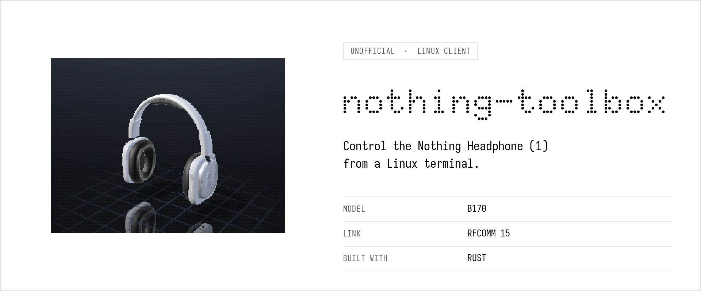
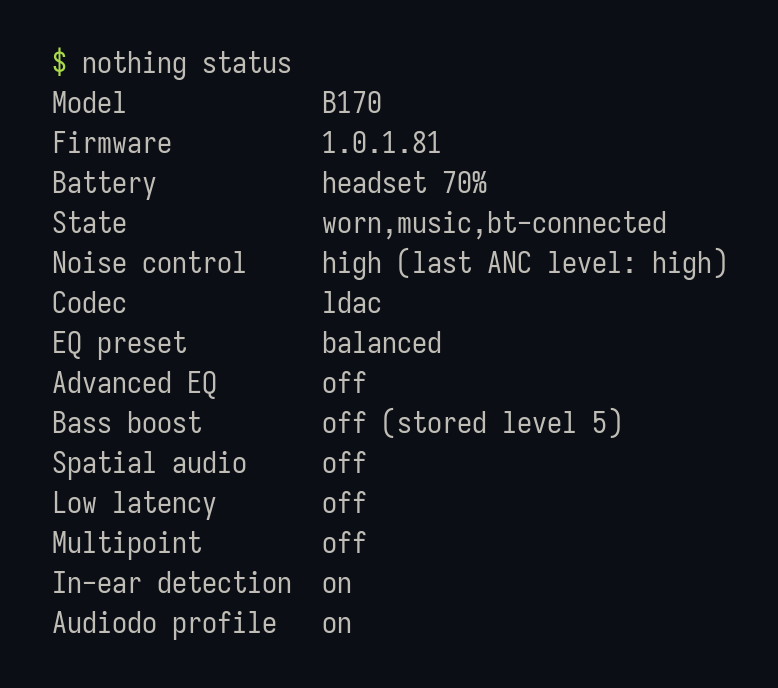
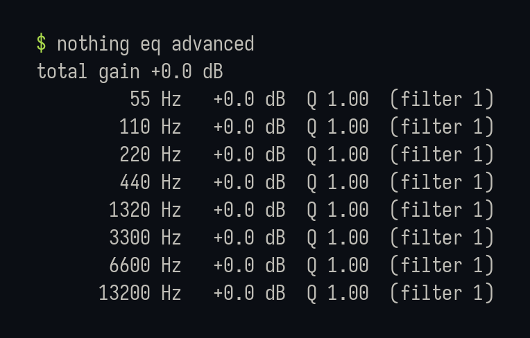
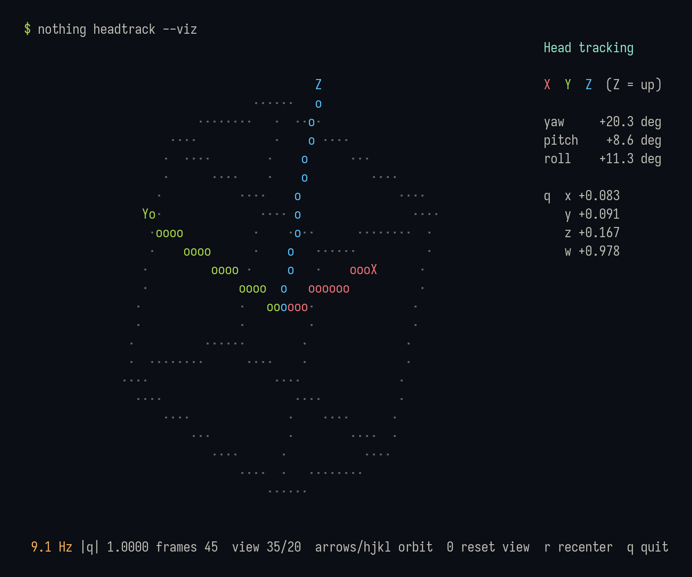
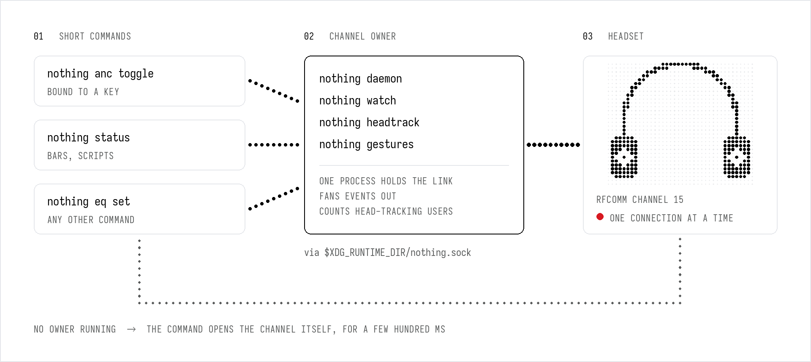

<p align="center">
  <picture>
    <source media="(prefers-color-scheme: dark)" srcset="docs/images/hero-dark.png">
    
  </picture>
</p>

<p align="center">
  <a href="https://github.com/marc-alexis-com/nothing-toolbox/actions/workflows/ci.yml"></a>
  <a href="LICENSE"></a>
  
  
</p>

**`nothing`** is a single command-line tool that controls the **Nothing Headphone (1)** from
Linux over its own Bluetooth control channel: noise cancelling, EQ, codec, battery and state,
the events the headset pushes (magic button included), its head-tracking sensor, and its
diagnostic logs. No phone, no app, no account.

> [!IMPORTANT]
> Only the **Nothing Headphone (1)** (model `B170`, firmware `1.0.1.81`) has been tested.
> Other Nothing and CMF products speak a related protocol but are **untested and unsupported**:
> `nothing` will read from them, and refuses to write unless you pass `--any-model`.

## Features

| Area | What you get |
|---|---|
| **Noise control** | high, mid, low, adaptive, off, transparency, and a toggle made for a keyboard shortcut |
| **Status** | battery, worn / playing state, codec, EQ, spatial audio, low latency, multipoint… one command, or JSON |
| **Sound** | EQ presets, custom and advanced curves (read), bass boost, spatial audio, low-latency mode |
| **Events** | live feed of what the headset pushes: battery, noise mode, state, Audiodo, **magic button** (run any command on press) |
| **Head tracking** | the headset's orientation sensor as a quaternion stream, or as a live 3D view in your terminal |
| **Controls** | remap the button and the wheel without the phone app |
| **Gestures** | nod to play/pause, shake to skip, through any media command (`playerctl` by default) |
| **Logs** | list and download the headset's diagnostic logs, read-only |
| **One channel, shared** | the headset allows one connection: `nothing` keeps one owner and routes everything through it |

## A look at it

<p align="center">
  
  
</p>

<p align="center">
  
  <br><sub><code>nothing headtrack --viz</code>, following a real head at 9 frames per second.</sub>
</p>

## Install

Requirements: Linux with BlueZ. There are no native dependencies: `nothing` opens a plain
RFCOMM socket, without D-Bus, and uses `bluetoothctl` only to find the connected headset.

**Prebuilt binary** (static, x86_64 or aarch64), from the
[releases page](https://github.com/marc-alexis-com/nothing-toolbox/releases):

```sh
curl -LO https://github.com/marc-alexis-com/nothing-toolbox/releases/latest/download/nothing-v0.1.0-x86_64-unknown-linux-musl.tar.gz
tar xzf nothing-v0.1.0-x86_64-unknown-linux-musl.tar.gz
install -Dm755 nothing-v0.1.0-x86_64-unknown-linux-musl/nothing ~/.local/bin/nothing
```

Each archive also holds shell completions; a `.sha256` file sits next to it.

**Nix** (flake, with completions):

```sh
nix run github:marc-alexis-com/nothing-toolbox -- status
nix profile install github:marc-alexis-com/nothing-toolbox
```

**From source** (a recent stable Rust toolchain):

```sh
cargo install --git https://github.com/marc-alexis-com/nothing-toolbox
```

Pair and connect the headset as usual (for example with `bluetoothctl`), then:

```sh
nothing status
```

`nothing` finds the headset among the connected devices by its Bluetooth vendor id, so a
renamed headset is still found. `--mac AA:BB:CC:DD:EE:FF` or `NOTHING_MAC` skip the lookup.

## Commands

```sh
nothing status [--json]              # everything at a glance
nothing anc get | set <mode> | toggle
nothing battery [--json]
nothing info                         # model, firmware, color, serial number, paired devices
nothing eq get | set <preset> | custom | advanced
nothing bass get | on [LEVEL] | off
nothing spatial get | set off|on|head-tracking
nothing latency    get | on | off
nothing multipoint get | on | off
nothing in-ear     get | on | off    # wear detection
nothing audiodo    get | on | off
nothing codec get                    # codec set aac|ldac needs --dangerous (reboots the headset)
nothing controls [get | set <control> <gesture> <action> | actions]
nothing watch [--on-magic CMD] [--headtrack] [--raw]
nothing headtrack [--viz]
nothing gestures [--dry-run] [--debug] [--nod-cmd CMD] [--shake-cmd CMD]
nothing logs list | info | debug | dump [-o FILE]
nothing daemon [status]
nothing raw <CMD> [HEX]              # one raw request, still subject to the safety policy
```

Noise modes: `high`, `mid`, `low`, `adaptive`, `off`, `transparency`. EQ presets: `balanced`,
`more-bass`, `more-treble`, `voice`, `custom`, `advanced`. Every command has `--help` (`-h` for a summary), with examples in the long form.

## One channel, shared

The headset accepts **a single connection** on its control channel. Whoever holds it locks
everybody else out (`EBUSY`), which used to break the noise-cancelling key as soon as anything
long-running listened to the headset.

<p align="center">
  <picture>
    <source media="(prefers-color-scheme: dark)" srcset="docs/images/architecture-dark.png">
    
  </picture>
</p>

- `nothing daemon`, `watch`, `headtrack` and `gestures` **own** the channel and serve every
  other invocation through a local socket, `$XDG_RUNTIME_DIR/nothing.sock` (mode `0600`).
- Every other command first looks for that owner; when there is none, it opens the channel
  itself for the duration of the command, a few hundred milliseconds.
- The head-tracking stream is reference-counted: the headset streams only while at least one
  client listens.

Measured on a B170: `nothing anc toggle` takes about 0.3 s on its own, and **50 ms** through
an owner, while a head-tracking session keeps running.

Running the daemon permanently is optional. While anything holds the channel, other clients,
such as the vendor's phone app, cannot connect to the headset.

## Recipes

**Noise-cancelling toggle on a key.** Hyprland:

```lua
hl.bind("F23", hl.dsp.exec_cmd("nothing anc toggle"), { locked = true })
```

```ini
# hyprland.conf (classic syntax)
bindl = , F23, exec, nothing anc toggle
# sway / i3
bindsym F23 exec nothing anc toggle
```

`toggle` reads the current mode first (the button on the headset or the phone may have changed
it): from any noise-cancelling level it goes to transparency, from anything else back to the
last noise-cancelling level. Failures are appended to `$XDG_RUNTIME_DIR/nothing.log`, since a
key binding throws stderr away.

**Magic button.** The headset reports presses of its customisable button. Map them to anything:

```sh
nothing watch --on-magic 'playerctl play-pause'
```

The command runs through `sh -c`, with the raw event payload in `$NOTHING_PAYLOAD`.

**Battery in a status bar.** Waybar:

```json
"custom/headphone": {
  "exec": "nothing battery",
  "interval": 120,
  "format": "🎧 {}"
}
```

**Remap the button.** The customisable button and the wheel accept the actions the vendor app
offers for them; `nothing controls actions` lists them.

```sh
nothing controls                          # current bindings
nothing controls set button hold spatial  # hold the button: spatial audio on/off
nothing controls set wheel hold none      # disable press-and-hold on the wheel
```

The change is written to the headset and survives without this tool.

**Shell completions.**

```sh
nothing completions zsh > ~/.zfunc/_nothing
nothing completions bash > ~/.local/share/bash-completion/completions/nothing
nothing completions fish > ~/.config/fish/completions/nothing.fish
```

**Head gestures.**

```sh
nothing gestures --dry-run --debug   # see what gets detected, and why
nothing gestures                     # nod: play/pause, shake: next track
```

A gesture has to be a quick back-and-forth on one dominant axis that returns to neutral; slow
head movements (looking around, leaning, tilting) are ignored, and the detector re-arms only once
the head is still again. On the B170 a nod is a rotation about the stream's X axis and a shake
about Z; both were checked against a labelled recording of real gestures, which the test suite
replays (3 nods, 3 shakes, no false positive during slow tilts).

The headset's orientation can drift: a steady rotation of about 20°/s around the vertical axis
was seen once, after a very long head-tracking session, and was gone after power-cycling the
headset. The detector learns such a drift and subtracts it. `--debug` prints, for every sample,
the measured amplitude, speed and drift estimate, to tune `--nod-amplitude`, `--nod-speed`,
`--shake-amplitude` and `--shake-speed` to your own way of moving.

## Safety

The headset will obey commands that reboot it, reset it to factory settings or forget paired
devices. `nothing` sorts every command code before anything leaves the computer:

| Class | Examples | Policy |
|---|---|---|
| Reads | battery, state, EQ, logs list | always allowed |
| Tested writes | noise mode, EQ preset, bass boost, spatial, latency, multipoint, wear detection, control bindings | allowed: each one was written, read back and reverted on a real B170 |
| Risky | codec change (reboots), factory reset, unpairing, test mode, any untested code | needs `--dangerous` |
| Firmware update | the whole OTA class | **never sent**, flashing is not implemented |

Writes are also refused when the headset does not report model `B170`, unless `--any-model`.

## Protocol

[docs/PROTOCOL.md](docs/PROTOCOL.md) describes the wire format and every command used here,
each fact marked as **confirmed** on the device, taken from the vendor app's behaviour, or
**inferred**. It is meant to be useful beyond this tool.

## Tested hardware

| Product | Model id | Firmware | Status |
|---|---|---|---|
| Nothing Headphone (1) | `B170` | `1.0.1.81` | tested, see below |
| Anything else | | | untested; reports welcome, writes refused by default |

On the B170, every read and every write listed under *Safety* was run with this tool and read
back, the pushed noise-control event was observed when pressing the headset's button, and the
gesture detector was checked against real head movements. Not yet exercised with this tool:
`codec set` (the same frames were, by hand), the magic-button event (a button set to noise
control reports a noise-control event instead), and `logs dump` with an actual log to download
(the test unit had none).

If you own another Nothing product and want to help, the output of `nothing status` and
`nothing info` (remove the serial number and addresses) in an issue is a good start.

## Troubleshooting

| Symptom | Likely cause |
|---|---|
| `no connected Nothing headset found` | The headset is not connected over Bluetooth, or `bluetoothctl` is missing: pass `--mac`. |
| `Device or resource busy` from another tool | Something else holds the channel. Use `nothing` for both, or stop the other tool. |
| The head-tracking view keeps turning while the head is still | Orientation drift inside the headset. Power-cycle it; gestures compensate on their own. |
| A key binding does nothing | Look at `$XDG_RUNTIME_DIR/nothing.log`. |
| Only the volume works on the headset; play/pause and the button do nothing | The headset probably thinks it is not worn (for example one ear cup off the ear): `nothing status` then shows `out`. Wear it properly, or turn wear detection off: `nothing in-ear off`. |

## Development

```sh
nix develop                           # optional: a shell with the Rust toolchain
cargo test                            # frames, decoders, safety policy, gesture detector, 3D view, --help
cargo clippy --all-targets -- -D warnings
cargo fmt --check
```

The source is small and dependency-light (`clap`, `libc`):

| File | Role |
|---|---|
| `src/frame.rs` | frame encoding, CRC-16/MODBUS, stream reassembly |
| `src/cmd.rs` | command codes and the safety policy |
| `src/decode.rs` | payload decoders, tested against real captures |
| `src/rfcomm.rs` | RFCOMM socket over libc |
| `src/link.rs` | one connection: reader thread, request/response matching |
| `src/hub.rs` | the channel owner: reconnects, subscribers, head-tracking reference count |
| `src/backend.rs` | local socket protocol, daemon detection |
| `src/headtrack.rs` | quaternion maths and the nod/shake detector |
| `src/viz.rs` | terminal 3D view |
| `src/main.rs` | the command line |

## Acknowledgements

The frame layout was first published by others, which got this project started:
[Kuksenok-i-s/nothing_helper](https://github.com/Kuksenok-i-s/nothing_helper), which supports
the Headphone (1) under its code name, and a write-up of the Ear (2) protocol on
[bharadwajraju.com](https://bharadwajraju.com).

## Legal

This is an independent interoperability project, built on hardware owned by the author. It is
not affiliated with, endorsed by or supported by Nothing Technology Limited. The repository
contains no firmware, application code, images or other material from Nothing, only a
description of the wire protocol and an original client. "Nothing" and "Nothing Headphone (1)"
are trademarks of their owner, used here only to name the hardware this tool talks to. The
illustrations are original: the LED-matrix drawings are generated by
[docs/images/render.py](docs/images/render.py) (fonts: Iosevka, and Doto under the SIL Open Font
License), the screenshots show this tool's real output.

Use at your own risk: the safety policy above limits what can be sent, it cannot guarantee
what the headset does with it.

## License

[MIT](LICENSE)
